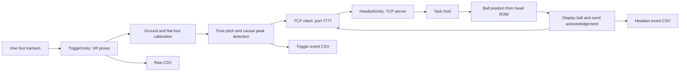

# Project guide and local setup

Reviewed on October 25, 2026. This copy is for development on a PC without the Quest or Vive trackers. Hardware validation will happen on the other PC.

Update: a separate vision-input experiment now exists under `VisionInput/` and `HeadsetUnity/Assets/Rehab/Vision/`, with its own desktop demo scene. See `VisionInput/README.md` for current run instructions and `VISION_FEATURE_PLAN.md` for implementation status. The review below describes the original Vive/Quest template; its original source and main scenes remain intact.

## How it works

There are two independent Unity **2022.3.30f1** projects and one local Unity package. Keep all three folders together; the package paths are relative.



The headset listens; the trigger PC initiates the connection. Messages are UTF-8 lines with a command and key/value fields, rather than JSON. Heel strikes carry IDs, foot side, sample indices, pitch values, calibration revision, and several timestamps. The headset returns an acceptance/rejection acknowledgement. Clock synchronization runs approximately every two seconds.

The detector works independently for each foot. It filters pitch with a second-order causal low-pass filter, tracks a rise and subsequent peak, and confirms the peak after a fall. Defaults: 6 Hz cutoff, 5 degree prominence, three falling samples, 0.5 degree confirmation drop, and 0.7 second refractory period per foot. Tracking gaps above 0.15 seconds reset the signal state. This is a pitch-peak heuristic; hardware accuracy has not been established by this review.

The ball task starts automatically. It remembers up to 512 event IDs, rejects duplicates or disabled sides, enforces a 0.2 second minimum spawn interval, and optionally requires ROM calibration. It replaces the current ball by default. The ball is 10 cm across, placed 1.5 m from the head, and expires after 1.5 seconds. There is no scoring, gaze interaction, or torch mechanic.

## Source file map

Paths below are relative to each folder. All 32 original project-owned C# files were reviewed. The new vision experiment is documented separately in `VisionInput/README.md`.

### Shared/com.mtpad.rehab.core

| File | Purpose |
| --- | --- |
| `package.json` | Local package name, version 0.1.0, Unity compatibility. |
| `Runtime/MTPAD.Rehab.Core.asmdef` | Shared assembly referenced by both projects. |
| `Runtime/IRehabTask.cs` | Task ID, running state, start/stop, and heel-strike handler contract. |
| `Runtime/RehabClock.cs` | Stopwatch-based monotonic time and UTC strings. |
| `Runtime/RehabCsvLogger.cs` | Append-mode, escaped, invariant-culture CSV writer with locking and autoflush. |
| `Runtime/RehabEventTypes.cs` | Foot side, tracker samples, heel strikes, acknowledgements, and spawn records. |
| `Runtime/RehabProtocol.cs` | Wire commands, encoding, quoted-field parsing, and numeric conversion. |
| `Runtime/RehabSessionContext.cs` | Participant/day/session and recording paths. |

### TriggerUnity/Assets/Rehab

| File | Purpose |
| --- | --- |
| `TriggerBootstrap.cs` | Finds and connects scene components in Awake. |
| `Tracking/UnityXrTrackerSource.cs` | Resolves trackers by serial or name; samples pose and validity each Update. |
| `Calibration/GroundFrameCalibration.cs` | Captures a horizontal heading and origin from both trackers; transforms poses into that frame. |
| `Gait/FootAngleEstimator.cs` | Flat-foot rotation calibration and signed pitch calculation. |
| `Gait/FootAngleSample.cs` | Pitch sample, validity, and source sample/time identifiers. |
| `Gait/CausalLowPassFilter.cs` | Second-order low-pass filter state and coefficient calculation. |
| `Gait/HeelStrikeDetector.cs` | Per-foot filtered peak detector, event IDs, thresholds, and live state. |
| `Gait/HeelStrikeTriggerController.cs` | Subscribes to detections, sends events, and records acknowledgements. |
| `Communication/HeadsetConnectionClient.cs` | Background TCP client, queues, reconnect attempts, RTT/clock offset estimates. |
| `Recording/TrackerRecorder.cs` | Explicitly started raw pose recording, including invalid samples. |
| `Recording/TriggerEventLogger.cs` | Lazy creation of detection/acknowledgement CSV. |
| `UI/TriggerStatusPanel.cs` | Desktop IMGUI panel, foot-angle histories, and event markers. |
| `Editor/TriggerTemplateSceneBuilder.cs` | Creates the template scene and configures the standalone OpenVR loader. |

### HeadsetUnity/Assets/Rehab

| File | Purpose |
| --- | --- |
| `HeadsetBootstrap.cs` | Resolves components and wires the default ball task into the task host. |
| `Calibration/MetaPassthroughSetup.cs` | Configures Meta camera rig, floor-level origin, transparent camera, and passthrough underlay. |
| `Calibration/CorridorFrame.cs` | Stores a floor origin/heading from the head, length, and width. |
| `Calibration/CrossSpaceRegistration.cs` | Solves yaw/translation from two point pairs; currently unused by the ball task. |
| `Calibration/RomCalibration.cs` | Collects head flexion/extension/left/right rotation maxima and placement heading. |
| `Communication/TriggerConnectionServer.cs` | Background single-client TCP listener, main-thread dispatch, sync replies, and acknowledgements. |
| `Tasks/RehabTaskHost.cs` | Starts/stops the selected IRehabTask and routes received events. |
| `Tasks/HeelStrikeBall/HeelStrikeBallTask.cs` | Acceptance rules, duplicate detection, placement/presentation calls, logging, and acknowledgement. |
| `Tasks/HeelStrikeBall/BallSpawnRegion.cs` | Seeded sampling of an elliptical ROM annulus at the chosen difficulty. |
| `Tasks/HeelStrikeBall/BallPresenter.cs` | Instantiates, colors, sizes, replaces, and expires the ball. |
| `Recording/HeadsetEventLogger.cs` | Records event outcome, timestamps, angles, and world position. |
| `UI/HeadsetStatusPanel.cs` | Optional IMGUI diagnostics; disabled in the saved scene. |
| `Editor/HeadsetTemplateSceneBuilder.cs` | Builds rig/task hierarchy and configures Android OpenXR/Meta features. |

## Scenes, configuration, and other files

- `README.md` introduces the template; `.gitignore` excludes caches, user settings, build outputs, logs, and generated IDE files.
- Each project's `Packages/manifest.json` lists direct dependencies; `packages-lock.json` records resolved versions. Shared core is `file:../../Shared/com.mtpad.rehab.core` in both. Headset uses Meta XR Core 81.0.0, OpenXR 1.10.0, and XR Management 4.5.1. Trigger uses XR Management 4.5.1 and the bundled OpenVR 1.2.1 archive.
- `TriggerUnity/LocalPackages/com.valvesoftware.unity.openvr-1.2.1.tgz` is a third-party package archive, not application code. Its package metadata was inspected; its SDK source was not audited file by file.
- `Assets/Scenes/Trigger_Main.unity` and `Headset_Main.unity` contain the saved component hierarchy, references, and Inspector values. These values override field initializers in C#.
- `HeadsetUnity/Assets/Prefabs/HeelStrikeBall.prefab` is a sphere with mesh renderer and collider, without a Rigidbody or task script.
- `Assets/XR/Loaders/*` selects OpenVR on the PC and OpenXR on Android. `XRGeneralSettingsPerBuildTarget.asset` links loaders and startup settings. Trigger's `OpenVRSettings.asset` uses initialization type 1. Headset's `OpenXRPackageSettings.asset` contains per-platform feature settings; Meta XR Feature is enabled on Android. `OpenXR Editor Settings.asset` enables the Meta feature set for Android.
- `HeadsetUnity/Assets/Oculus/OculusProjectConfig.asset` stores Meta device/platform capabilities. Its passthrough support setting still needs checking in Meta Project Setup before a hardware build.
- `HeadsetUnity/Assets/Resources/ImmersiveDebuggerSettings.asset`, `InputActions.asset`, `OculusRuntimeSettings.asset`, and `OVRPlatformToolSettings.asset` are SDK settings: debugger disabled, empty SDK input action definitions, runtime options, and upload-tool options respectively.
- The 77 `.meta` files contain Unity GUIDs and importer settings. Preserve them with their corresponding files when moving this project or sending changes to the hardware PC.
- Each `ProjectSettings/ProjectVersion.txt` pins the editor version. `EditorBuildSettings.asset` selects the one main scene and XR settings references. `ProjectSettings.asset` holds player/build settings; the headset application ID is `com.roarlab.mtpad.rehabtemplate`.
- `GraphicsSettings.asset` uses the built-in render pipeline. `QualitySettings.asset` holds quality presets. `InputManager.asset` contains legacy input axes; `activeInputHandler` is legacy on Trigger and Both on Headset.
- `AudioManager.asset`, `DynamicsManager.asset`, `Physics2DSettings.asset`, `TimeManager.asset`, `NavMeshAreas.asset`, `TagManager.asset`, and `VFXManager.asset` contain engine subsystem defaults. There is no custom gait logic in these files.
- `EditorSettings.asset`, `MemorySettings.asset`, `PresetManager.asset`, `PackageManagerSettings.asset`, `SceneTemplateSettings.json`, `VersionControlSettings.asset`, `UnityConnectSettings.asset`, `ClusterInputManager.asset`, and `XRPackageSettings.asset` cover editor serialization, memory defaults, presets, registry, templates, visible metadata, disabled cloud services, empty cluster inputs, and XR migration settings.
- `Library/` contains generated import databases, compiled assemblies, shaders, and downloaded third-party package code. `Logs/`, root import/validation `.log` files, and `UserSettings/` contain diagnostics or editor preferences. They are inventoried as generated/local state, not reviewed as authored application code. Logs reference an earlier `D:\mTPAD Xincheng\...` location; they are not a successful test on this PC.
- At the initial review this directory had no Git history, solution file, automated test suite, or CI configuration. Git was subsequently initialized for the `roar_heelstrike_game` repository, and the vision experiment now includes automated tests. The README's `MetaTrigger` and `TryARVR2` reference projects are absent from this directory.

## Local setup without hardware

1. Install [Unity Hub](https://unity.com/download), sign in, and activate the license appropriate to your account.
2. Install the project's pinned [Unity 2022.3.30f1](https://unity.com/releases/editor/whats-new/2022.3.30f1). This establishes a baseline without a version migration. Include **Android Build Support**, **Android SDK & NDK Tools**, and **OpenJDK** if you will build APKs here. Unity documents those modules in its [Android setup guide](https://docs.unity3d.com/2022.3/Documentation/Manual/android-sdksetup.html).
3. In Hub, add `TriggerUnity` and `HeadsetUnity` as separate projects. Keep `Shared` beside them. Open each with the pinned editor and let package resolution/import complete.
4. Open `Assets/Scenes/Trigger_Main.unity` or `Assets/Scenes/Headset_Main.unity` in the corresponding editor. Check Console for compilation errors before Play mode.
5. For code editing, use your preferred C# editor. Unity can generate solution/project files; their absence in this copy is expected.
6. For a local TCP check, open both Unity projects, set Trigger's `HeadsetConnection.headsetAddress` to `127.0.0.1` in Play mode, and run the headset scene first. Both use port 7777. Restore the real headset address when transferring changes to the hardware PC. Trigger will have no valid tracker input here, so this checks connection/sync only.

The original template has no tracker simulator or synthetic heel-strike control. The new vision experiment has a manual hand-state sender and an ordinary desktop camera in its separate scene. Editor Play mode cannot establish that walking detection, Quest passthrough, or physical calibration works. In the original headset scene, inspect the rig camera/Scene view if no device-driven Game view is available.

Do not use the `mTPAD/Rebuild ... Template Scene` commands for routine setup: they replace the saved scene. The builders already configure project settings during editor initialization and only auto-create a scene if it is missing.

Run the read-only prerequisite check from this directory:

```powershell
.\scripts\Check-Setup.ps1
# For a nonstandard editor install:
.\scripts\Check-Setup.ps1 -UnityEditorPath 'D:\Unity\2022.3.30f1\Editor\Unity.exe'
```

On this review's PC, the standard Unity/Hub locations and Hub editor registry were absent, Steam was present but SteamVR was not found in its listed libraries, and the winget executable could not be launched. Compilation and Play mode have therefore **not** been verified here.

## Hardware PC handoff

Transfer the authored `Assets` (including `.meta`), `Packages`, `ProjectSettings`, `LocalPackages`, and `Shared` contents as needed. Generated `Library`, `Logs`, and `UserSettings` are machine-specific. Record the hardware PC's actual headset address and tracker serials before replacing its scenes with this template copy.

For the PC side, start the existing SteamVR/tracker setup, verify both devices are discovered, assign their serials, capture **Ground Frame**, then **Flat-Foot Calibration**. The saved serials are `LHR-1AAD87ED` and `LHR-CC44460A`; the saved headset address is `192.168.1.2`. Treat them as existing configuration to verify rather than this PC's detected devices.

For a Quest APK, switch HeadsetUnity to Android and run Meta/OpenXR Project Validation. The saved player settings currently use ARMv7 (`AndroidTargetArchitectures: 1`), no explicit IL2CPP selection, minimum SDK 22, and gamma color space. Configure the device-required Android settings, including **IL2CPP and ARM64**, and resolve Meta passthrough/project validation before building. See [Android's Unity 64-bit instructions](https://developer.android.com/games/optimize/64-bit#unity_developers). No APK build has been verified in this review.

Session metadata is independent on each application: align participant/day/session manually. Raw recording must be started explicitly; event recording starts lazily when events arrive. Files append under `Application.persistentDataPath/RehabRecordings/<participant>/<day>/<session>/` unless `recordingRoot` is set:

- Trigger: `tracker_raw.csv` and `trigger_events.csv`.
- Headset: `headset_ball_events.csv`.

Use a fresh session name for each run. Join event logs by `eventId`; do not directly subtract monotonic timestamps from different computers. Clock offset/RTT are currently displayed in memory, not saved as a synchronization history in CSV.

## Findings relevant to future changes

These are source-review findings, not changes applied to gameplay:

- `HeadsetBootstrap.ResolveAndWire()` always sets `activeTaskBehaviour` to the ball task. Merely assigning another task in the Inspector, as the README suggests, will be overwritten during Awake. Extending task selection requires adjusting that wiring.
- Ground-frame capture assumes the XR runtime already provides a level floor at Y=0. It derives heading from tracker orientations, not an independently measured floor plane.
- Cross-space registration and corridor dimensions do not constrain ball positions. The ball uses current head position and a ROM/base heading.
- Calibration is stored in component fields; the code does not persist a newly captured calibration across launches. Editor Play-mode changes normally disappear when stopping Play mode.
- Tracker timestamps are PC polling times, not native tracker acquisition timestamps. Update methods do not declare an explicit execution order, so pipeline stages may observe a previous frame's sample.
- Networking polls `DataAvailable` and `TcpClient.Connected`; orderly disconnect detection and rapid stop/restart behavior need runtime testing. Worker join timeouts are shorter than the client's connection timeout. Outgoing queues are not cleared between sessions.
- Sending an event means enqueueing it; there is no delivery retry or acknowledgement timeout. Some numeric protocol fields silently default to zero when missing or malformed.
- Logging autoflushes synchronously on the Unity thread. Participant details and full calibration/sync histories are not exported with the current CSVs.
- The ball task remains a presentation task. Changes to actual interaction or scoring belong in a task implementation, with protocol changes only when additional PC data is required.
