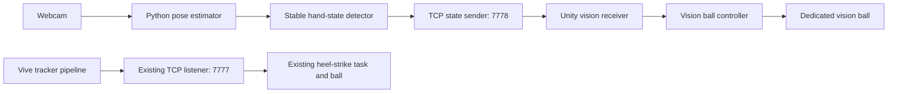

# Vision input experiment: implementation plan and handoff

Last updated: October 25, 2026.

## Current status

**The user confirmed the initial manual and webcam demo works. The latest update adds independent left/right balls and random placement per raise.** Ten Python tests, ten receiver network checks, and ten actual Unity Play-mode checks pass for the updated code. User validation of the updated live-camera behavior is pending. Read this file together with `PROJECT_GUIDE.md` and `VisionInput/README.md` before continuing work.

The user develops on this PC. The Meta Quest headset and Vive trackers are attached to another PC. The first demonstration must therefore work in the Unity editor with an ordinary camera, without requiring the hardware PC.

## Agreed behavior

- Raising a hand shows a dedicated vision ball.
- Lowering the hand removes that vision ball.
- Keeping the hand raised keeps the same vision ball visible; it must not repeatedly spawn objects.
- Latest user request: left hand controls a ball on the left of the screen, right hand controls a ball on the right, with random positions similar to the heel-strike task. Implemented: one ball per side; both can appear. A new raise samples a new position on its side; holding stays still, lowering hides only that side.
- This is a separate ball from the heel-strike ball, with separate ownership and visibility control.
- Preserve the existing Vive tracking, heel-strike detection, networking, task, and recording behavior. Both inputs must be able to operate together eventually.
- The first experiment is a side feature. It does not replace the main task or pretend that a hand gesture is a heel strike.

## Proposed defaults and open decisions

These are implementation proposals, not additional user requirements:

| Item | Proposed starting point | Status |
| --- | --- | --- |
| Camera | Built-in or USB webcam, configurable camera index | Actual camera not yet confirmed; default index 0 |
| Model | MediaPipe Pose Landmarker Lite with the Tasks API | Implemented using MediaPipe 0.10.21 on isolated Python 3.11.9; model loaded and blank-frame inference passed |
| Gesture | Wrist above its corresponding shoulder | Validate against camera placement |
| Hand selection | Either hand; one independently controlled ball per hand | Configurable left/right/either; both raised shows two balls |
| Participants | One visible participant | Multi-person selection is outside the first milestone |
| Stability | About 200 ms to confirm up/down, plus separate up/down thresholds | Tune after camera testing |
| Ball appearance | Green balls randomly placed on their corresponding screen side on each raise | Configurable viewport ranges; stationary during each hold |
| Connection | Python client to a dedicated Unity listener, TCP port 7778 | Keep configurable |
| Recovery | Periodic state refresh, immediate state on reconnect, stale-state timeout | Initial proposal: 5 updates/sec and 1 second timeout |

The model and Python compatibility were checked before installation. Direct package versions and a complete resolved Windows Python 3.11 lock file are in `VisionInput/`. There is no custom training requirement for the first experiment.

## Architecture



Python inference is outside Unity in `VisionInput/`, with pinned dependencies, a camera preview, and a README. Because this PC had no runnable system Python, a project-local embeddable runtime and packages were installed under `.tools/python311` without modifying PATH. Regular Python virtual-environment instructions are also documented for other PCs.

Put the Unity experiment under `HeadsetUnity/Assets/Rehab/Vision/`. Provide a dedicated desktop scene, proposed path `HeadsetUnity/Assets/Scenes/Vision_DesktopDemo.unity`, containing a normal camera, lighting, diagnostics, the vision receiver, and the vision ball controller. It must not depend on Meta camera tracking or call the existing headset bootstrap. Build that scene as a separate asset; do not regenerate or replace the main scenes.

Reuse those vision components in the headset scene later, behind an explicit enable setting. The receiver binds to loopback for the local demo; configure a LAN interface/address deliberately for the hardware-PC experiment.

The existing `TriggerConnectionServer` accepts one client at a time. A second client on its port could compete with the Vive PC. Use a separate listener on port 7778 so the two inputs can coexist without changing that server.

The existing `BallPresenter` owns one active heel-strike ball and normally expires it after 1.5 seconds. Use a dedicated vision controller/object with no fixed visibility lifetime while valid raised-state updates continue. Hand lowering must only affect the vision object. Do not route the vision feature through `RehabTaskHost.activeTaskBehaviour`: the bootstrap currently forces that field to the heel-strike task.

## State detection and communication

Distinguish `raised`, `lowered`, and `unknown`. Missing landmarks, low confidence, a missing participant, or a camera failure must not be classified as a confidently lowered hand. For the proposed either-hand mode: any confidently raised hand means raised; both confidently lowered hands mean lowered; otherwise report unknown.

Normalize wrist/shoulder separation by a body scale so thresholds do not depend directly on image resolution. In image coordinates, upward usually means a smaller Y value; verify this with the chosen API. Use separate enter/exit thresholds and elapsed time to stabilize the gesture rather than counting frames. Mirror the preview without accidentally swapping the participant's anatomical left/right labels.

Send the current state on changes **and periodically while unchanged**. Change-only messages cannot recover safely from a lost connection or prove that the vision process is still alive.

Suggested wire format: versioned newline-delimited JSON on the new port. Example only; finalize during implementation:

```json
{"v":2,"type":"hand_state","sessionId":"demo-unique-id","sequence":42,"hand":"either","state":"raised","confidence":0.94,"sourceTime":123.456,"leftState":"lowered","rightState":"raised","leftConfidence":0.9,"rightConfidence":0.94}
```

- Each connection/session has a distinct ID and increasing sequence numbers. Reconnection sends the latest stable state.
- Receive bytes and parse complete lines with a maximum message length; reject unsupported versions, invalid enums, and invalid/nonfinite numeric fields.
- Apply Unity object changes on the main thread. Repeated raised/lowered states are idempotent.
- Use Unity's local monotonic receipt time for freshness. Python timestamps and Unity timestamps are not directly comparable.
- Start with the ball hidden. Unknown state may retain the last confirmed state briefly, but hide after the configured tracking-loss grace period even if unknown messages keep arriving.
- Also hide after a connection/state timeout, receiver disable, or Play-mode exit. A live connection sending unknown poses must not keep a stale raised state forever.
- On reconnect or after tracking recovery, restore visibility from a fresh stable state; do not replay queued old gestures.
- Version 2 carries both hands in one update; confidence, tracking-loss grace, and ball visibility are handled independently. Version 1 remains accepted; legacy `either` applies the same state to both balls because no side distinction is available.

## Build sequence

- [x] Review existing source, scenes, dependencies, and setup limitations.
- [x] Record requirements and proposed architecture in this file.
- [ ] Install/locate Unity 2022.3.30f1 and verify HeadsetUnity compiles on this PC.
- [x] Implement the separate desktop demo scene and a manual state sender, before installing a vision model.
- [ ] Verify manual raised/lowered messages control only the vision ball, including repeated messages and timeout behavior.
- [x] Choose a pretrained pose model and compatible Python version; install and verify model loading/inference. Live camera access remains to be checked.
- [x] Implement webcam preview with landmarks, confidence, and stable up/down/unknown status.
- [ ] Connect the vision sender to the desktop scene and validate the full camera-to-ball loop.
- [x] Add concise setup/run instructions and focused tests for state stabilization, stream parsing, and recovery.
- [x] Provide an editor menu to add inactive optional vision components to the current scene; preserve existing scenes and Vive behavior.
- [ ] Validate optional components in Headset_Main on the hardware PC.
- [ ] On the hardware PC, verify Quest rendering and simultaneous Vive/vision input.

## Acceptance checks

| Scenario | Expected result |
| --- | --- |
| Start Unity before Python | Ball hidden; receiver ready |
| Raise selected hand and hold | One vision ball appears after stabilization and stays visible |
| Lower selected hand | Vision ball disappears after stabilization |
| Repeated raised updates | Same object remains; no extra spawns or position jumps |
| Wrist jitters near shoulder | No rapid visibility flickering |
| Either-hand mode: one lowers while other remains raised | Only lowered hand's ball hides; raised hand's ball stays visible and stationary |
| Lower and re-raise one hand | That ball gets a new random position on its side; other side is unchanged |
| Pose confidence lost / person exits / camera blocked | Unknown shown; vision ball hides after tracking-loss grace period |
| Python stops or connection drops | Vision ball hides after stale-state timeout |
| Reconnect with hand raised | Fresh state restores a single ball |
| Invalid message or split/coalesced TCP lines | No crash or unintended visibility change; framing handled correctly |
| Exit/re-enter Play mode | Listener releases the port; clean hidden initial state |
| Heel strike while vision ball is visible | Heel-strike ball appears independently |
| Lower hand while heel-strike ball exists | Only the vision ball is removed |

Local editor testing establishes the camera/network/game-state loop. It does not establish physical tracker accuracy, Quest passthrough, or headset placement; those require the other PC.

## Unity setup: what the user should do now

Unity is required to see the game scene respond. The pose preview can run separately once its Python app exists.

1. Install [Unity Hub](https://unity.com/download), sign in, and activate the license applicable to your account.
2. Install **Unity 2022.3.30f1**, matching both projects' `ProjectVersion.txt`. Use the [official release page](https://unity.com/releases/editor/whats-new/2022.3.30f1) if Hub's default install list does not show it.
3. For this desktop Play-mode milestone, the base Windows editor is sufficient. Android Build Support, Android SDK/NDK Tools, and OpenJDK are needed later if building the Quest APK here; see [Unity's Android setup guide](https://docs.unity3d.com/2022.3/Documentation/Manual/android-sdksetup.html).
4. In Hub's Projects list, use Add/Open project from disk and select **`RehabTemplate/HeadsetUnity`**, not the RehabTemplate parent folder. Keep `Shared` at its current sibling location.
5. Let Unity import packages and compile. Open **Window > General > Console** and note any red errors. The existing `Headset_Main` scene remains the original task; use the separate desktop scene for this experiment.
6. Open `Assets/Scenes/Vision_DesktopDemo.unity`, enter Play mode, and run `.\scripts\Run-Vision.ps1 -Mode manual` from the RehabTemplate directory. Use `lu` / `ld` for left up/down, `ru` / `rd` for right, `u` / `d` for both, and `q` to quit. Then try `.\scripts\Run-Vision.ps1 -Mode webcam`. Full instructions are in `VisionInput/README.md`.

You do not need to open TriggerUnity or install SteamVR for the first vision demonstration. Leave the existing rebuild-template menu commands alone; they replace the saved template scenes.

Optional prerequisite check from the RehabTemplate directory:

```powershell
.\scripts\Check-Setup.ps1
# If Unity is installed elsewhere:
.\scripts\Check-Setup.ps1 -UnityEditorPath 'D:\Unity\2022.3.30f1\Editor\Unity.exe'
```

## Handoff notes for the next working session

- Confidence display restored after the side-specific update: Unity and the webcam preview each show a separate left/right score to two decimal places. Unity shows `--` when no fresh state is available. The confidence values were still calculated/sent; only the overlay labels had been omitted.
- User confirmed both manual and live-webcam vision input work in the Unity editor on this laptop. Unity 2022.3.30f1 is now installed and HeadsetUnity opens on the Windows target.
- Latest change: independently track anatomical left/right hand states in Python, send atomic version 2 snapshots, expose both sides in the receiver, and present one green ball per hand at a random location on that screen side. Both raised shows two. Hand lowering/loss affects only that side; held hands do not move the balls; a new raise repositions. The original Vive code is untouched. Run commands are unchanged; restart the Python sender and Unity Play mode to load updated code.
- Previous request: experience the original Vive-driven game updates on the laptop, independently of vision. Added `HeelStrike_DesktopDemo.unity`, `Simulation/HeelStrikeDesktopDemo.cs`, and `Editor/HeelStrikeDesktopMenu.cs`. Open via mTPAD > Heel Strike > Open Desktop Demo; Play; click left/right buttons or use L/R. Optional Auto walk alternates every 0.8 seconds. This directly invokes the original ball task with synthetic heel strikes, with original placement/lifetime defaults, without hardware/network/recording. User has now tried it and observed the randomized ball updates.
- Confirmed: local development PC has no Quest/Vive hardware; preserve existing Vive functionality; separate ball controlled by hand up/down.
- Unconfirmed: camera source, preferred hand, and precise headset presentation location. Implemented defaults: camera 0, either hand, green ball centered in the desktop view. The model is MediaPipe Pose Landmarker Lite; replacing it later only needs to preserve the hand-state protocol.
- Initial setup had no Unity installation; this is resolved. The original copied import logs still refer to a different project path. User-confirmed editor/vision success above supersedes the earlier setup limitation.
- Verification completed: eight Python tests; ten C# receiver network checks using Unity stubs/.NET JSON (not native Unity); Python source compilation; MediaPipe/OpenCV import; blank-frame inference and Google's sample-pose image (one person, 33 landmarks, valid shoulder/wrist confidence and hand-state output); pip dependency consistency; downloaded model SHA-256 verification.
- Verification for the side-specific change: 10 Python tests, 10 C# receiver network checks, and 10 native Unity Play-mode checks in an isolated headless project. Unity checks include native JSON, sides/positions, object reuse, stable holds, new positions on raises, tracking loss, stale connections, and new-connection reset. Latest live-webcam behavior still needs the user to try it. Quest rendering and real Vive tracking remain unverified on the other PC.
- Existing main scenes, Vive source, shared contracts, and headset task/bootstrap were not modified. The optional integration menu creates a new inactive object and referenced material only when invoked.
- Entry points: `scripts/Run-Vision.ps1`, `scripts/Setup-Vision.ps1`, `scripts/Test-VisionReceiver.ps1`, and `VisionInput/README.md`.
